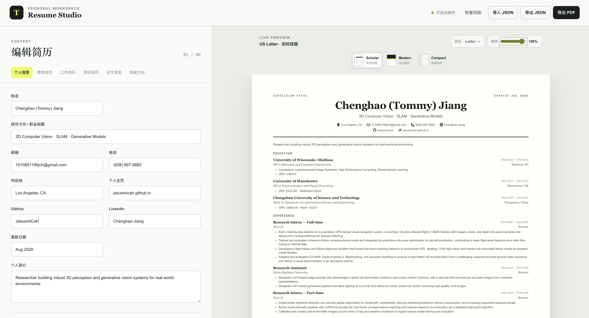

# Resume Studio

Resume Studio is a privacy-first workspace for maintaining a structured resume, previewing it in multiple PDF-ready layouts, and preparing the stories behind each experience for interviews.

The current release focuses on resume editing and export. Interview-design and mock-interview workflows are planned as the next product surface; private interview notes are intentionally excluded from this repository.



## Features

- Edit profile, education, experience, projects, publications, and skills
- Select text and use Bold or Insert link in titles, authors, skills, and descriptions; keyboard shortcuts are Cmd/Ctrl+B and Cmd/Ctrl+K
- Keep publication status separate from location, and emphasize individual author names
- Switch the editor interface between English and Chinese, with English as the default
- Preview changes immediately in Scholar, Modern, and Compact templates
- Switch between US Letter and A4 page sizes
- Export a print-ready PDF through the browser
- Import and export portable JSON backups
- Restore the latest draft automatically on the same browser and device
- Open email, phone, GitHub, LinkedIn, and personal-site links directly from the rendered resume
- Keep resume data in browser storage instead of uploading it to a server

## Product direction

Resume Studio is designed around two connected workflows:

1. **Resume editing** — maintain one structured source of truth and render it into different application-ready layouts.
2. **Interview design** — turn resume bullets into accurate narratives, technical walkthroughs, likely follow-up questions, and repeatable mock-interview practice.

Interview-preparation content is personal and is not tracked by Git.

## Local development

Requirements: Node.js 22.13 or newer.

```bash
npm install
npm run dev
```

Create a production build with:

```bash
npm run build
```

## Data and privacy

Resume drafts are stored in the browser's local storage. They persist when the same site is reopened from the same browser profile, but they do not automatically follow the user to another browser or device. JSON export provides a portable backup.

Formatted fields accept `**bold**` and `[link text](https://example.com)`. The toolbar inserts this notation for selected text; the live preview and printed resume display the formatting. Link labels can include bold text. Supported destinations are HTTP, HTTPS, and `mailto:`; HTML and unsupported links are displayed as text. Bold applied across multiple highlight lines stays within each line. Use a backslash to escape a literal formatting character.

JSON backups include `schemaVersion`, `contentVersion`, and `resume`. Import accepts these backups and older flat JSON exports. Explicit imports preserve the supplied content rather than reapplying historical personal-content corrections. Browser drafts and explicit imports preserve personal content; migrations only normalize data structure, such as publication status fields. Formatting remains in string fields, so it survives JSON round trips without an external editor or dependency. Publication statuses formerly stored in `location` are migrated when recognized; legacy locations remain in backups but are not printed, and an explicitly cleared status stays empty.

Run `npm test` for the production build plus inline formatting, content migration, backup, and rendered-template checks.

Do not commit personal interview notes, confidential employer information, or exported resume JSON files containing data that should remain private.

## Technology

- React 19
- TypeScript
- vinext and Vite
- Tailwind CSS
- React Icons
- Cloudflare Workers-compatible deployment output

## Template and local imports

`app/resume-builder.tsx` implements the editor and resume preview. Its generic initial content lives in `app/resume-template.json`; edit that file to change the template. Education, experience and other entries are arrays: add, remove and reorder entries in the UI without changing source code. Reset template restores sample content, not a personal resume.

Click **Import JSON**, navigate to the local `outputs/` folder (or any folder on your computer), and select a `.json` backup. On macOS, use Cmd+Shift+G in the file picker to enter the folder path. The browser reads only the selected file; private files in `outputs/` are not served or bundled with the website. Import replaces the editor content; Export JSON saves the current content as `resume.json`.

Drafts now use the generic `resume-studio-v1` browser storage key. The previous key is read as a fallback to preserve existing drafts without rewriting their personal content. A fresh browser starts with the sample template; an existing browser keeps its saved draft until you import or reset.
